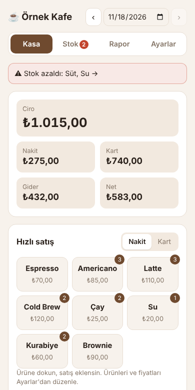
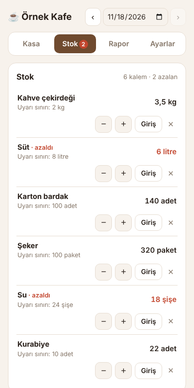
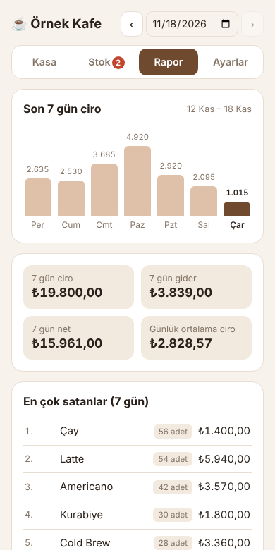

# ☕ Kafe Stok ve Kasa Defteri

Küçük kafeler için telefonda çalışan satış, gider, kasa sayımı ve stok takibi. Kurulum, hesap ya da internet gerektirmez.

▶️ **[Uygulamayı aç](https://bmihci.github.io/kafe-stok-kasa-defteri/)** · "Örnek verilerle dene" ile bir haftalık örnek kafe verisini görebilirsin.

<p align="center">
  
  
  
</p>

## Neler yapar?

- **Hızlı satış:** Ürüne dokun, satış eklensin. Nakit ya da kart seçilir, düğmede o günün satış adedi görünür.
- **Gider kaydı:** Süt alımı, kira, fatura gibi giderleri tutarıyla ekle.
- **Gün sonu kasa sayımı:** Açılış kasası + nakit satış − nakit gider ile kasada olması gereken parayı hesaplar; saydığın tutarı yazınca eksik ya da fazlayı gösterir.
- **Stok takibi:** Her kalem için uyarı sınırı belirlenir. Sınıra inen kalemler kırmızıya döner ve kasa ekranında uyarı çıkar. Alım girerken maliyet yazarsan gider olarak da kaydedilir.
- **Gün sonu raporu:** Günün cirosu, nakit/kart dağılımı, giderler, kasa farkı, en çok satanlar ve azalan stok tek dokunuşla WhatsApp, e-posta ya da not uygulamasına gönderilir veya panoya kopyalanır.
- **Rapor:** Son 7 günün cirosu, gideri, neti ve en çok satan ürünler.
- **Excel'e aktarma:** Satışlar, giderler, günlük özet ve stok listesi CSV olarak iner, Excel'de doğrudan açılır.
- **Yedek:** Tüm kayıtlar tek dosya olarak indirilip başka cihaza yüklenebilir.
- **Geçmiş günler:** Tarih seçerek önceki günlere unutulan satış ya da gider eklenebilir.

## Telefonda uygulama gibi kullanma

Bağlantıyı telefonda açıp tarayıcı menüsünden **"Ana ekrana ekle"** de. Uygulama simgesiyle açılır ve internet olmadan da çalışır.

## Veriler nerede?

Tüm kayıtlar yalnızca kullanılan cihazın tarayıcısında saklanır, hiçbir sunucuya gönderilmez. Tarayıcı verileri silinirse kayıtlar da silinir; bu yüzden Ayarlar'dan düzenli yedek almak önerilir.

## Teknik

Tek dosya HTML, CSS ve JavaScript; bağımlılık yok. Veriler `localStorage`'da tutulur, service worker ile çevrimdışı çalışır.

```
index.html             Uygulamanın tamamı
sw.js                  Çevrimdışı çalışma
manifest.webmanifest   Ana ekrana ekleme
```

---

© 2026 Barış Mıhçı
